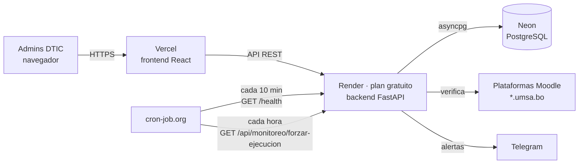

# Backend — Monitoreo de Campus Virtuales UMSA (DTIC)

API que verifica cada hora que las plataformas virtuales (Moodle) de la UMSA
respondan, guarda el historial, abre/cierra tickets de incidencia, avisa por
Telegram y genera el informe PDF de monitorización.

**Stack:** Python 3.12 · FastAPI · SQLModel/SQLAlchemy async (asyncpg) ·
Alembic · httpx · ReportLab · PostgreSQL (Neon).

Frontend: [`PV_frontend`](https://github.com/xXCrIs7xDXx/PV_frontend) (React + Vite).

---

## Cómo está desplegado



| Pieza | Servicio | Detalle |
|---|---|---|
| Backend (este repo) | **Render** (Web Service, gratuito) | Se despliega solo con cada push a `main`. |
| Frontend | **Vercel** | Se despliega solo con cada push a `main` de `PV_frontend`. |
| Base de datos | **Neon** (PostgreSQL) | La URL va en `DATABASE_URL`. |
| Programador | **cron-job.org** | Mantiene despierto Render y dispara el monitoreo (ver abajo). |

### Por qué cron-job.org

Render gratuito **duerme el servicio tras 15 min sin tráfico** y lo reinicia
cuando quiere, así que el backend **no tiene un programador interno**. Dos
tareas en cron-job.org (zona horaria `America/La_Paz`):

| Tarea | URL | Frecuencia |
|---|---|---|
| Keep-alive | `GET https://<tu-backend>.onrender.com/health` | cada 10 minutos |
| Monitoreo | `GET https://<tu-backend>.onrender.com/api/monitoreo/forzar-ejecucion` | cada hora (`0 * * * *`) |

`forzar-ejecucion` responde al instante y corre el ciclo en segundo plano
(cron-job.org corta la espera a los 30 s). Después del ciclo se borra el
historial más antiguo que `RETENCION_REGISTROS_MESES`.

> Si defines `CRON_TOKEN` en Render, la URL del monitoreo pasa a ser
> `.../forzar-ejecucion?token=<CRON_TOKEN>` (actualízala en cron-job.org).

**Si el monitoreo se detiene** (el historial deja de crecer): revisa en
cron-job.org el *History* de la tarea (si falló muchas veces la desactiva sola)
y en Render → *Logs* si el servicio está caído o sin horas gratuitas.

### Configuración en Render

- **Build Command:** `pip install -r requirements.txt`
- **Start Command:** `uvicorn app.main:app --host 0.0.0.0 --port $PORT`
- **Environment:** las variables de [`.env.example`](.env.example). Como
  mínimo `DATABASE_URL`, `ADMIN_PASSWORD` y `CORS_ORIGINS` con el dominio de
  Vercel (ej. `https://pv-frontend.vercel.app`). Para las alertas:
  `TELEGRAM_ENABLED=true`, `TELEGRAM_BOT_TOKEN`, `TELEGRAM_CHAT_ID`.
- Las versiones de `sqlmodel` y `sqlalchemy` están topadas en
  `requirements.txt` a propósito (ver el comentario ahí): no las subas sin
  probar.

### Cambios en la base de datos (Alembic)

Render gratuito no ejecuta comandos antes del deploy, así que las migraciones
se corren **desde tu PC** contra Neon, **antes** de hacer el merge del código
que las necesita (todas las migraciones solo agregan columnas, el código
anterior sigue funcionando):

```powershell
alembic upgrade head      # aplica las migraciones pendientes
alembic current           # muestra la version actual
```

Para crear una nueva: `alembic revision -m "descripcion"` y escribe el
`upgrade()`/`downgrade()` a mano en `alembic/versions/`.

---

## Ejecutar en local

Requisitos: Python 3.12+ y acceso a una base PostgreSQL (la de Neon u otra).

```powershell
cd PV
python -m venv venv
.\venv\Scripts\Activate.ps1          # en Linux/Mac: source venv/bin/activate
pip install -r requirements.txt
copy .env.example .env               # y completa DATABASE_URL y ADMIN_PASSWORD
uvicorn app.main:app --reload --port 8000
```

- Documentación interactiva de la API (Swagger): http://localhost:8000/docs
- `--reload` recarga al cambiar archivos `.py`, **no** al cambiar el `.env`:
  si tocas el `.env`, reinicia uvicorn (Ctrl+C y vuelve a ejecutarlo).
- ⚠️ Si tu `.env` apunta a la base de Neon de producción, **todo lo que hagas
  en local cambia los datos reales**. Deja `TELEGRAM_ENABLED=false` para no
  mandar alertas al grupo. Para probar sin riesgo, crea una *branch* de la base
  en Neon y usa su URL.
- Con la base vacía: `alembic upgrade head` crea las tablas.

Para levantar también el frontend, ver el README de `PV_frontend`
(`npm run dev` usa este backend en `localhost:8000` automáticamente).

---

## Estructura

```
app/
  main.py               App FastAPI, CORS y /health
  config.py             Variables de entorno (.env)
  db.py                 Motor y sesiones async
  auth_state.py         Tokens firmados del modo admin
  models/               Tablas (SQLModel)
  schemas/              Modelos de entrada/salida de la API
  routers/              Endpoints (/api/...)
  services/
    monitor_engine.py   Ciclo de monitoreo (httpx) y confirmación de caídas
    tickets_service.py  Apertura/cierre automático de tickets
    telegram_service.py Alertas de caída/recuperación
    informe_service.py  Datos e informe PDF (actual o de un día del historial)
    forms_service.py    Envío manual a los Google Forms de auditoría
    retencion_service.py Purga del historial antiguo
alembic/                Migraciones
scripts/test_google_forms.py  Envía UNA fila de prueba a los Google Forms
```

## Cómo funciona el monitoreo

1. Cada hora se hace un `GET` a la URL de cada plataforma (timeout
   `MONITOR_TIMEOUT_SECONDS`). Responde < 400 → operativa.
2. Se guarda una fila por plataforma en `registro_monitoreo` (agrupadas por
   `ejecucion_monitoreo`), con el estado que tenía en ese momento.
3. Una plataforma pasa a **En Revisión** recién tras
   `MONITOR_CONFIRM_FAILURES` fallos seguidos (se cuentan desde el historial,
   así sobreviven a los reinicios de Render). Se abre un ticket y se avisa
   por Telegram **una sola vez**.
4. Cuando vuelve a responder pasa a **Operativo**, se cierra el ticket y se
   avisa la recuperación.
5. Los estados manuales (*En Mantenimiento*, *Error*, *Fuera de Servicio*)
   pausan los cambios automáticos hasta que un admin los quite.

## Endpoints principales

Las rutas `GET` son públicas; las que modifican datos exigen el token de
`POST /api/auth/login` (`Authorization: Bearer <token>`, válido 12 h).

| Ruta | Uso |
|---|---|
| `GET /health` | Keep-alive |
| `GET /api/monitoreo/forzar-ejecucion` | Ciclo de monitoreo (cron-job.org) |
| `POST /api/monitoreo/ejecutar` | Botón "Verificar ahora" (admin) |
| `GET /api/plataformas`, `/servidores`, `/responsables`, `/unidades` | Catálogos (CRUD con admin) |
| `GET /api/dashboard/resumen` | Totales del panel |
| `GET /api/monitoreo/ejecuciones` | Historial de verificaciones |
| `GET /api/stats/comparar?fecha_a=&fecha_b=` | Comparativa entre dos días |
| `GET /api/informes/datos?fecha=` | Datos del informe (sin fecha = estado actual) |
| `POST /api/informes/pdf` | Genera el PDF (admin) |
| `POST /api/monitoreo/enviar-forms` | Envía el último estado a Google Forms (admin) |

La lista completa está en `/docs`.
