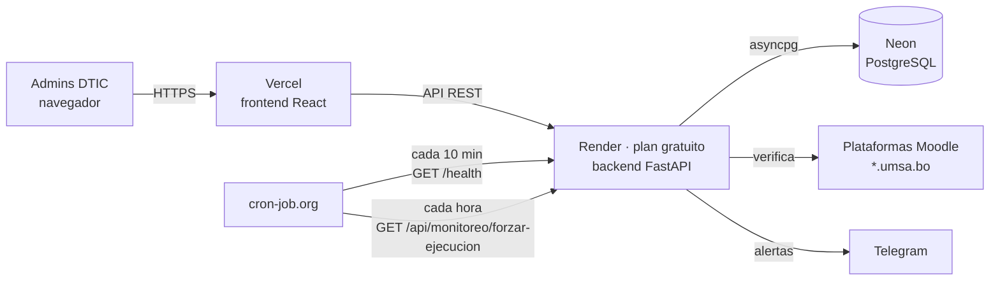

# Backend — Monitoreo de Campus Virtuales UMSA (DTIC)

API que verifica cada hora que las plataformas virtuales (Moodle) de la UMSA
respondan, guarda el historial, abre/cierra tickets de incidencia, avisa por
Telegram y genera el informe PDF de monitorización.

**Stack:** Python 3.12 · FastAPI · SQLModel/SQLAlchemy async (asyncpg) ·
Alembic · httpx · ReportLab · PostgreSQL (Neon).

Frontend: [`PV_frontend`](https://github.com/xXCrIs7xDXx/PV_frontend) (React + Vite).

---

## Cómo está desplegado



| Pieza | Servicio | Detalle |
|---|---|---|
| Backend (este repo) | **Render** (Web Service, gratuito) | Se despliega solo con cada push a `main`. |
| Frontend | **Vercel** | Se despliega solo con cada push a `main` de `PV_frontend`. |
| Base de datos | **Neon** (PostgreSQL) | La URL va en `DATABASE_URL`. |
| Programador | **cron-job.org** | Mantiene despierto Render y dispara el monitoreo (ver abajo). |

### Por qué cron-job.org

Render gratuito **duerme el servicio tras 15 min sin tráfico** y lo reinicia
cuando quiere, así que el backend **no tiene un programador interno**. Dos
tareas en cron-job.org (zona horaria `America/La_Paz`):

| Tarea | URL | Frecuencia |
|---|---|---|
| Keep-alive | `GET https://<tu-backend>.onrender.com/health` | cada 10 minutos |
| Monitoreo | `GET https://<tu-backend>.onrender.com/api/monitoreo/forzar-ejecucion` | cada hora (`0 * * * *`) |

`forzar-ejecucion` responde al instante y corre el ciclo en segundo plano
(cron-job.org corta la espera a los 30 s). Después del ciclo se borra el
historial más antiguo que `RETENCION_REGISTROS_MESES`.

> Si defines `CRON_TOKEN` en Render, la URL del monitoreo pasa a ser
> `.../forzar-ejecucion?token=<CRON_TOKEN>` (actualízala en cron-job.org).

**Si el monitoreo se detiene** (el historial deja de crecer): revisa en
cron-job.org el *History* de la tarea (si falló muchas veces la desactiva sola)
y en Render → *Logs* si el servicio está caído o sin horas gratuitas.

### Configuración en Render

- **Build Command:** `pip install -r requirements.txt`
- **Start Command:** `uvicorn app.main:app --host 0.0.0.0 --port $PORT`
- **Environment:** las variables de [`.env.example`](.env.example). Como
  mínimo `DATABASE_URL`, `ADMIN_PASSWORD` y `CORS_ORIGINS` con el dominio de
  Vercel (ej. `https://pv-frontend.vercel.app`). Para las alertas:
  `TELEGRAM_ENABLED=true`, `TELEGRAM_BOT_TOKEN`, `TELEGRAM_CHAT_ID`.
- Las versiones de `sqlmodel` y `sqlalchemy` están topadas en
  `requirements.txt` a propósito (ver el comentario ahí): no las subas sin
  probar.

### Cambios en la base de datos (Alembic)

Render gratuito no ejecuta comandos antes del deploy, así que las migraciones
se corren **desde tu PC** contra Neon, **antes** de hacer el merge del código
que las necesita (todas las migraciones solo agregan columnas, el código
anterior sigue funcionando):

```powershell
alembic upgrade head      # aplica las migraciones pendientes
alembic current           # muestra la version actual
```

Para crear una nueva: `alembic revision -m "descripcion"` y escribe el
`upgrade()`/`downgrade()` a mano en `alembic/versions/`.

---

## Ejecutar en local

Requisitos: Python 3.12+ y acceso a una base PostgreSQL (la de Neon u otra).

```powershell
cd PV
python -m venv venv
.\venv\Scripts\Activate.ps1          # en Linux/Mac: source venv/bin/activate
pip install -r requirements.txt
copy .env.example .env               # y completa DATABASE_URL y ADMIN_PASSWORD
uvicorn app.main:app --reload --port 8000
```

- Documentación interactiva de la API (Swagger): http://localhost:8000/docs
- `--reload` recarga al cambiar archivos `.py`, **no** al cambiar el `.env`:
  si tocas el `.env`, reinicia uvicorn (Ctrl+C y vuelve a ejecutarlo).
- ⚠️ Si tu `.env` apunta a la base de Neon de producción, **todo lo que hagas
  en local cambia los datos reales**. Deja `TELEGRAM_ENABLED=false` para no
  mandar alertas al grupo. Para probar sin riesgo, crea una *branch* de la base
  en Neon y usa su URL.
- Con la base vacía: `alembic upgrade head` crea las tablas.

Para levantar también el frontend, ver el README de `PV_frontend`
(`npm run dev` usa este backend en `localhost:8000` automáticamente).

---

## Estructura

```
app/
  main.py               App FastAPI, CORS y /health
  config.py             Variables de entorno (.env)
  db.py                 Motor y sesiones async
  auth_state.py         Tokens firmados del modo admin
  models/               Tablas (SQLModel)
  schemas/              Modelos de entrada/salida de la API
  routers/              Endpoints (/api/...)
  services/
    monitor_engine.py   Ciclo de monitoreo (httpx) y confirmación de caídas
    tickets_service.py  Apertura/cierre automático de tickets
    telegram_service.py Alertas de caída/recuperación
    informe_service.py  Datos e informe PDF (actual o de un día del historial)
    forms_service.py    Envío manual a los Google Forms de auditoría
    retencion_service.py Purga del historial antiguo
    backups_vigilancia.py Avisa si el agente de respaldos deja de responder
  backups/              Agente de respaldos Google Drive -> D: (corre en Windows)
alembic/                Migraciones
scripts/test_google_forms.py  Envía UNA fila de prueba a los Google Forms
scripts/instalar_tarea_respaldos.ps1  Registra el agente en el Programador de tareas
tests/                  Pruebas (pytest) del módulo de respaldos
```

## Cómo funciona el monitoreo

1. Cada hora se hace un `GET` a la URL de cada plataforma (timeout
   `MONITOR_TIMEOUT_SECONDS`). Responde < 400 → operativa.
2. Se guarda una fila por plataforma en `registro_monitoreo` (agrupadas por
   `ejecucion_monitoreo`), con el estado que tenía en ese momento.
3. Una plataforma pasa a **En Revisión** recién tras
   `MONITOR_CONFIRM_FAILURES` fallos seguidos (se cuentan desde el historial,
   así sobreviven a los reinicios de Render). Se abre un ticket y se avisa
   por Telegram **una sola vez**.
4. Cuando vuelve a responder pasa a **Operativo**, se cierra el ticket y se
   avisa la recuperación.
5. Los estados manuales (*En Mantenimiento*, *Error*, *Fuera de Servicio*)
   pausan los cambios automáticos hasta que un admin los quite.

## Endpoints principales

Las rutas `GET` son públicas; las que modifican datos exigen el token de
`POST /api/auth/login` (`Authorization: Bearer <token>`, válido 12 h).

| Ruta | Uso |
|---|---|
| `GET /health` | Keep-alive |
| `GET /api/monitoreo/forzar-ejecucion` | Ciclo de monitoreo (cron-job.org) |
| `POST /api/monitoreo/ejecutar` | Botón "Verificar ahora" (admin) |
| `GET /api/plataformas`, `/servidores`, `/responsables`, `/unidades` | Catálogos (CRUD con admin) |
| `GET /api/dashboard/resumen` | Totales del panel |
| `GET /api/monitoreo/ejecuciones` | Historial de verificaciones |
| `GET /api/stats/comparar?fecha_a=&fecha_b=` | Comparativa entre dos días |
| `GET /api/informes/datos?fecha=` | Datos del informe (sin fecha = estado actual) |
| `POST /api/informes/pdf` | Genera el PDF (admin) |
| `POST /api/monitoreo/enviar-forms` | Envía el último estado a Google Forms (admin) |

La lista completa está en `/docs`.

---

## Respaldos de Google Drive → disco D: (agente en Windows)

Descarga cada día los respaldos de los servidores que los scripts Linux ya
suben a la carpeta compartida **`Backupumsa2627`** de Google Drive, los
verifica y los conserva en `D:\Backups` de la PC de la DTIC, con un registro
diario por servidor y por archivo. **No toca** los scripts Linux ni la subida a
Drive, y **nunca** borra, mueve ni sobrescribe nada (ni en Drive ni en D:).

### Por qué tiene dos partes

El backend corre en Render (Linux, en la nube) y no ve las unidades `G:`/`D:`
de la PC. Por eso:

| Parte | Dónde corre | Qué hace |
|---|---|---|
| **Agente** (`app/backups/`) | PC con Windows 11 (sesión del usuario que tiene Drive) | Lee `G:`, copia a `D:`, verifica SHA-256, escribe los registros y guarda el estado en **la misma base de Neon** |
| **API** (`/api/backups/...`) | Render | Panel: estado, servidores, historial, logs, CSV. "Ejecutar ahora" y "Reintentar fallidos" dejan una solicitud en la base que el agente toma en < 1 min |
| **Vigilancia** | Render (cada hora, con el cron del monitoreo) | Avisa por Telegram si el agente deja de dar señales (PC apagada, sesión cerrada), si no hubo ejecución en 26 h o si una se colgó |

### Origen: el acceso directo `.lnk`

La carpeta pertenece a otra cuenta y en `G:\Mi unidad` aparece como
`Backupumsa2627.lnk`, que **no** es una carpeta. El agente resuelve su destino
real (`G:\.shortcut-targets-by-id\<id>\Backupumsa2627`) y comprueba que se pueda
listar antes de usarlo. Si cambia de lugar, se puede fijar con
`BACKUPS_RUTA_ORIGEN`. Para verlo:

```powershell
python -m app.backups.agente diagnostico   # solo lee: servidores, tamaños, espacio libre
```

### Estructuras reconocidas (13/11/2026)

Un *respaldo* es cualquier carpeta con archivos; se reconoce por su nombre. Los
servidores se descubren en cada ejecución (no hay lista fija).

| Tipo | Ejemplo | Verificación |
|---|---|---|
| `estandar` | `2-CV-IQPAAB-GV-DTIC/2026-11-13_02-00-01/` o `6-CV-MOODLE-GV-DTIC/cvpfo/2026-11-13_03-00-01/` con `codigo_*`, `db_*`, `[data_*]`, `hash_verificacion.txt` | **SHA-256** de cada archivo contra el manifiesto, que además debe listar exactamente los archivos presentes e incluir `codigo_` y `db_` → `VALIDADO` |
| `docker_moodle` | `14-CVDEFENSORIA/cvdefensoria_moodle_08-11-2026-020001/` (`*_db_backup.sql` + `*_moodledata.tar.gz`) | Sin manifiesto: solo tamaño → `SIN_HASH` |
| `docker_cursos` | `.../cvelectronica_cursos_08-11-2026-020028/` (`cursos.txt` + `*.mbz`) | Cantidad de `.mbz` contra `cursos.txt`, y tamaño → `SIN_HASH` |
| desconocido | archivos sueltos en la carpeta del servidor, otros nombres | Se registra y se avisa (la 1.ª vez); **no se descarga** |

`SIN_HASH` = copia completa verificada **solo por tamaño**; nunca se presenta
como validada criptográficamente.

### ¿Cuándo un respaldo de Drive está "completo"?

Los scripts Linux no publican un marcador de fin (`BACKUP_COMPLETO.ok`), así
que se aplica una política conservadora: antigüedad mínima desde la última
modificación (30 min con manifiesto / 180 min sin él), tamaños iguales en dos
sondeos separados, conjunto esperado de archivos y manifiesto coherente. Lo que
no cumple queda `PENDIENTE`/`INCOMPLETO` y se reevalúa en la siguiente
ejecución. Esto reduce el riesgo pero **no garantiza** que el respaldo sea
restaurable: hay que hacer pruebas de restauración periódicas.

### Qué hace cada ejecución

1. Bloqueo exclusivo (nunca dos ejecuciones a la vez).
2. Verifica la base, el destino y el acceso a Drive.
3. Descubre servidores y respaldos; da de alta los nuevos en la base.
4. Lo ya `VALIDADO`/`SIN_HASH` y presente en D: cuenta como `YA_EXISTENTE` (por evidencia en la base, no por el nombre).
5. Lo demás: segundo sondeo → política de finalización → cola (primero lo pequeño y antiguo, los de 50 GB al final; tope opcional `BACKUPS_MAX_GB_POR_EJECUCION`).
6. Copia en streaming a `D:\Backups\_TEMPORAL\...\archivo.part` calculando el SHA-256 al vuelo; si se corta, la próxima vez **reanuda** desde donde quedó. Antes comprueba el espacio libre en D: (`BACKUPS_MARGEN_MINIMO_LIBRE_GB`) y en el volumen de la caché de Drive; si no alcanza se detiene sin borrar nada (`SIN_ESPACIO`).
7. Si el hash no coincide (`ERROR_INTEGRIDAD`) el archivo no se publica y se reintenta; los errores de transferencia se reintentan con espera progresiva.
8. Con todos los archivos verificados, publica el respaldo en `D:\Backups\Backupumsa2627\<misma ruta que en Drive>` (movimiento atómico dentro de D:). Si algo ya existe en D: con otro contenido, **no se sobrescribe**: se registra el conflicto.
9. Alerta si un servidor/plataforma lleva más que su ritmo habitual (diario, semanal…) sin respaldo nuevo; mínimo `BACKUPS_HORAS_SIN_BACKUP_ALERTA` (30 h).
10. Escribe el registro del día y manda un resumen por Telegram **solo** si hubo errores o alertas.

### Registros (`D:\Backups\Registros\AAAA-MM-DD\`)

Se escriben **siempre**, aunque no haya novedades o Drive no esté accesible:
`ejecucion.log`, `resumen_diario.csv` (por servidor), `detalle_archivos.csv`
(por archivo: hash esperado/obtenido, estado, verificación `SHA256`/`LIMITADA`)
y `resumen_diario.json`. Los mensajes del servicio van a
`D:\Backups\Registros\agente.log`. El panel muestra además la cola del log y
los eventos de cada ejecución.

Estados de archivo: `DETECTADO`, `PENDIENTE`, `INCOMPLETO`, `EN_DESCARGA`,
`DESCARGADO` (verificado, falta publicar), `VALIDADO`, `SIN_HASH`,
`YA_EXISTENTE` (solo en el detalle del día), `ERROR_INTEGRIDAD`,
`ERROR_TRANSFERENCIA`, `ERROR_ACCESO`, `SIN_ESPACIO`, `NO_RECONOCIDO`.

### Instalación en la PC con Windows

1. Aplica la migración (solo crea tablas `backup_*` nuevas): `alembic upgrade head`,
   e instala las dependencias del agente: `pip install -r requirements-agente.txt`.
2. En `PV\.env` (además de `DATABASE_URL` y `ADMIN_PASSWORD`):

   ```ini
   # URL pública del backend: el agente late contra él y NO despierta la base en reposo
   BACKUPS_BACKEND_URL=https://<tu-backend>.onrender.com
   # Hoja de registro para compartir (dentro de la unidad de Google Drive)
   BACKUPS_HOJA_RUTA=G:\Mi unidad\Respaldos DTIC\Registro de respaldos Backupumsa2627.xlsx
   BACKUPS_DESTINO_RAIZ=D:\Backups
   BACKUPS_HORA_DIARIA=10:00
   # BACKUPS_RUTA_ORIGEN=                  vacío = resolver el .lnk automáticamente
   # BACKUPS_INCLUIR= / BACKUPS_EXCLUIR=   nombres de servidor separados por coma
   # BACKUPS_MAX_GB_POR_EJECUCION=0        0 = sin tope (la primera trae ~152 GB)
   # BACKUPS_LIMITE_MBPS=0                 0 = sin límite de ancho de banda
   # BACKUPS_MARGEN_MINIMO_LIBRE_GB=20
   # BACKUPS_REINTENTOS=5
   # BACKUPS_ALERTAS_TELEGRAM=true         usa TELEGRAM_* (requiere TELEGRAM_ENABLED=true)
   ```

   Todas las opciones están en `app/backups/config.py`.
3. Prueba: `python -m app.backups.agente diagnostico` y luego
   `python -m app.backups.agente inventario` (registra lo que hay sin descargar).
4. Primera descarga a mano, para seguirla en la consola: `python -m app.backups.agente ejecutar`.
5. Deja el servicio permanente: `.\scripts\instalar_tarea_respaldos.ps1`.
   Arranca al iniciar sesión (espera 2 min a que Drive monte `G:`), se
   reinicia si se cae, ejecuta a `BACKUPS_HORA_DIARIA` (10:00) y, si la PC estaba
   apagada a esa hora, ejecuta al encender. Si la ejecución diaria termina en
   ERROR (p. ej. Drive aún no montó `G:`), se reintenta hasta 2 veces más, cada
   30 min. Para quitarlo: `-Desinstalar`.

> El agente necesita la **sesión del usuario** con Google Drive para escritorio
> abierto: como servicio de Windows sin sesión, `G:` no existe. Con la PC
> apagada o suspendida no descarga nada; al volver retoma lo pendiente (las
> descargas cortadas se reanudan desde el `.part`).

### Hoja de registro para compartir (Google Sheets)

Al final de cada ejecución el agente regenera un `.xlsx` en
`BACKUPS_HOJA_RUTA`, **dentro de tu Google Drive** (lo sube Drive para
escritorio; no hacen falta credenciales ni la API de Google). En
drive.google.com se abre con Google Sheets y se comparte con *Compartir →
enlace*. El archivo se sobrescribe en el mismo lugar, así que el enlace no
cambia. Es un reporte: lo que se edite a mano se pierde en la siguiente
ejecución.

| Pestaña | Contenido |
|---|---|
| Resumen | Fecha de actualización, última ejecución, espacio en D: y estado por servidor |
| Registro diario | Una fila por ejecución (también las que no trajeron nada o fallaron) |
| Copias por día | Qué se copió cada día por servidor: respaldos, archivos, GB, validados |
| Respaldos | Inventario: una fila por respaldo con su estado y cuándo se copió |
| Archivos copiados | Una fila por archivo copiado, con su SHA-256 |
| Avisos | Advertencias y errores recientes |

### Uso de los planes gratuitos (Render y Neon)

- **Neon** suspende el cómputo a los 5 min sin consultas y solo cuentan las
  horas activas. Por eso el agente **no consulta la base en reposo**: cada
  minuto llama a `POST /api/backups/agente/latido`, que responde desde memoria
  (`app/services/backups_enlace.py`). Solo se toca la base cuando hay una
  solicitud del panel o una ejecución. El latido se guarda en la base una vez
  por hora, dentro del ciclo de monitoreo, que ya la despertó.
- Esa llamada por minuto mantiene despierto a **Render** mientras la PC está
  encendida. El keep-alive de cron-job.org (`/health`, que tampoco toca la
  base) sigue siendo necesario para cuando la PC está apagada.
- Render gratuito da 750 horas de instancia al mes **por cuenta**: un servicio
  despierto 24 h usa ~744. No agregues otro servicio gratuito en la misma
  cuenta o se quedará sin horas antes de fin de mes.
- Almacenamiento (Neon gratuito: 0,5 GB): `registro_monitoreo` se purga a los
  `RETENCION_REGISTROS_MESES`; de los respaldos, la base solo conserva el log
  de las últimas 30 ejecuciones y los eventos de 180 días (los registros
  completos quedan en `D:\Backups\Registros`).
- El panel de respaldos refresca cada minuto y solo con la pestaña visible.

### API del panel (todas exigen sesión admin, también los GET)

| Ruta | Uso |
|---|---|
| `GET /api/backups/resumen` | Agente (activo, espacio en D:, config), última ejecución, totales, alertas |
| `GET /api/backups/servidores` · `PATCH /api/backups/servidores/{id}` | Servidores con estado `OK`/`PENDIENTE`/`ERROR`/`VACIO`; habilitar o deshabilitar |
| `GET /api/backups/respaldos?id_servidor_backup=&estado=` | Respaldos (`estado=ERRORES` para los fallidos) |
| `GET /api/backups/respaldos/{id}/archivos` · `GET /api/backups/archivos?estado=` | Archivos con hash esperado y local |
| `GET /api/backups/ejecuciones` · `/ejecuciones/{id}` · `/ejecuciones/{id}/log` | Historial, eventos y log |
| `GET /api/backups/exportar/ejecuciones.csv` · `/exportar/inventario.csv` | Exportación CSV |
| `POST /api/backups/ejecutar` · `/reintentar-fallidos` · `/inventario` | Solicitudes al agente |

### Pruebas

```powershell
pip install pytest aiosqlite
python -m pytest tests -q
```

Usan SQLite y carpetas temporales: no tocan Neon, Drive ni D:.
